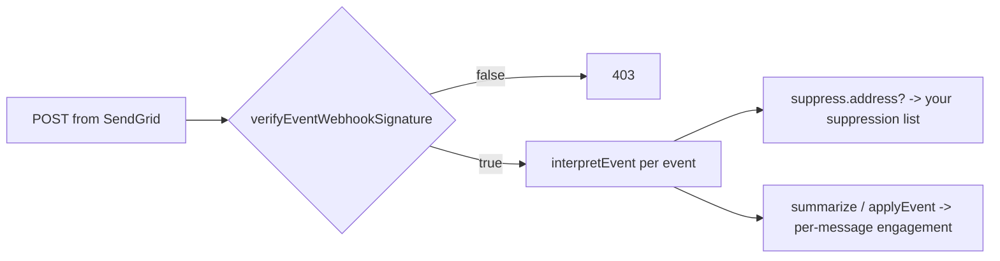

# sendgrid-event-kit

Make sense of SendGrid's Event Webhook. Turn each raw event into a plain answer: did a **person** open the email or was it a machine, is a bounce about the **address** or about **you**, and should the address be **suppressed**. Fold the events into per-message engagement, and check that each request really came from SendGrid (Signed Event Webhook).

```js
import express from 'express';
import { verifyEventWebhookSignature, interpretEvents, SIGNATURE_HEADER, TIMESTAMP_HEADER } from 'sendgrid-event-kit';

app.post('/webhooks/sendgrid', express.raw({ type: 'application/json' }), async (req, res) => {
  const ok = verifyEventWebhookSignature({
    publicKey: process.env.SENDGRID_WEBHOOK_PUBLIC_KEY,   // the verification key from SendGrid's settings
    payload: req.body,                                    // raw Buffer: don't parse and re-stringify
    signature: req.get(SIGNATURE_HEADER),
    timestamp: req.get(TIMESTAMP_HEADER),
    toleranceSeconds: 600                                 // optional replay window
  });
  if (!ok) return res.sendStatus(403);

  const events = JSON.parse(req.body);
  const sends = await db.sendTimes(events.map((e) => e.sg_message_id?.split('.')[0]));
  for (const result of interpretEvents(events, (e) => sends[e.sg_message_id?.split('.')[0]] ?? {})) {
    if (result.suppress.address) await db.suppress(result.email, result.suppress.reason);
    await db.saveEvent(result);
  }
  res.sendStatus(200);
});
```

```js
interpretEvent({ event: 'open', email: 'Ada@Example.com', timestamp: 1795186804, ip: '66.249.84.1',
  useragent: 'Mozilla/5.0 (via ggpht.com GoogleImageProxy)', sg_message_id: 'abc123.filter...', contactId: 'c42' },
  { sentAt: '2026-11-20T15:00:00Z' });
// {
//   type: 'machine_open', reason: 'too_soon_after_send', event: 'open',
//   at: 2026-11-20T15:00:04.000Z, email: 'ada@example.com', messageId: 'abc123', eventId: null,
//   ip: null, url: null, suppress: { address: false, reason: null }, customArgs: { contactId: 'c42' }
// }
```

No dependencies. Node 20+. Storage-agnostic: no database, no required IDs; your `custom_args` come back in `customArgs`.



## What each event becomes

| SendGrid event | `type` | `suppress` | Notes |
|---|---|---|---|
| `processed`, `deferred` | same | no | `reason` carries the SMTP response for deferrals |
| `delivered` | `delivered` | no | |
| `open` with `sg_machine_open: true` | `machine_open` | no | Apple Mail Privacy Protection, as flagged by SendGrid (`reason: 'apple_mpp'`) |
| `open` less than `machineOpenWindowMs` (30 s) after `sentAt` or `followUpSentAt` | `machine_open` | no | Gmail prefetch, corporate scanners (`reason: 'too_soon_after_send'`) |
| other `open` | `open` | no | `ip` is the reader's, or `null` behind the Gmail / Yahoo image proxy |
| `click` | `click` | no | `url`, `ip`, `impliesOpen: true` (images may have been blocked) |
| `bounce`, `type: 'bounce'` | `bounce` | `bounce` | `classification` from `bounce_classification` |
| `bounce`, `type: 'blocked'` | `sender_block` | **no** | The receiver rejected *you* (reputation, content, volume); the address may be fine |
| `bounce`, `type: 'blocked'`, but the reply says the address doesn't exist | `bounce` | `bounce` | SendGrid files replies it doesn't recognize as blocks, e.g. Proofpoint's `550 #5.1.0 Address rejected.` (see `isUnknownRecipient`) |
| `dropped`: "Bounced Address", "Invalid" | `dropped` | `bounce` | |
| `dropped`: "Spam Reporting Address" | `dropped` | `spam_report` | |
| `dropped`: "Unsubscribed Address", "Group Unsubscribe" | `dropped` | `unsubscribe` | |
| `dropped`: "Invalid SMTPAPI header", "Invalid Template", "Spam Content", "Expired"... | `dropped` | no | About the request or content, not the address |
| `spamreport` | `spam_report` | `spam_report` | |
| `unsubscribe` | `unsubscribe` | `unsubscribe` | `suppress.group: null` (global) |
| `group_unsubscribe` | `unsubscribe` | `unsubscribe` | `suppress.group` is the `asm_group_id`: suppress for that group only |
| a test send (custom arg `test` = `'1'`, `'true'`, `1`, `true`) | `ignored` | no | Test sends often reuse a real recipient: never let them suppress anyone |
| anything else (`group_resubscribe`, junk) | `ignored` | no | `reason` says why; never throws |

Every result: `{ type, event, at, email, messageId, eventId, ip, url, reason, suppress: { address, reason }, customArgs }`. `at` is a `Date` (13-digit timestamps are read as milliseconds). `email` is trimmed and lower-cased. `messageId` is `sg_message_id` up to the first dot, the same as the `X-Message-Id` you got when sending.

## API

```js
import {
  interpretEvent, interpretEvents, summarize, summarizeBy, applyEvent, emptySummary,
  verifyEventWebhookSignature, toPublicKey, readerIp, isMachineOpenTime, isUnknownRecipient, customArgsOf, messageIdOf
} from 'sendgrid-event-kit';
```

| Function | |
|---|---|
| `interpretEvent(event, { sentAt, followUpSentAt, machineOpenWindowMs = 30000, isTest, now })` | One event to a result (table above) |
| `interpretEvents(events, options \| (event) => options)` | A whole payload; options can be looked up per event |
| `summarize(events, options)` | Engagement for one message from raw events or results |
| `summarizeBy(events, { key, options })` | `Map` of message id (or `key(result)`) to summary |
| `applyEvent(summary, result)` / `emptySummary()` | The reducer behind `summarize`, for incremental updates |
| `verifyEventWebhookSignature({ publicKey, payload, signature, timestamp, toleranceSeconds, now })` | `true` only for a valid signature; never throws |
| `isUnknownRecipient(reason, classification)` | Whether a rejection says the recipient's address doesn't exist (`5.1.x` address codes or wording like "user unknown"), not that the sender was refused |
| `readerIp(event)`, `isMachineOpenTime(sentAt, at, windowMs)`, `customArgsOf(event)`, `messageIdOf(event)` | The building blocks |

A summary has `deliveredAt`, `firstOpenAt`, `lastOpenAt`, `humanOpens`, `machineOpens`, `clicks`, `firstClickAt`, `urls`, `readerIps`, `deferrals`, `bouncedAt`/`bounceReason`, `senderBlockedAt`/`senderBlockReason`, `droppedAt`/`dropReason`, `spamReportedAt`, `unsubscribedAt`, the strongest `suppress` seen (spam report > bounce > unsubscribe), and the flags `delivered`, `opened`, `clicked`, `bounced`, `senderBlocked`, `dropped`, `spamReported`, `unsubscribed`. A click counts as opened but not as an extra `humanOpens`. Events with an `sg_event_id` already seen are skipped, since SendGrid delivers at least once.

## Signed Event Webhook

Per [SendGrid's security docs](https://www.twilio.com/docs/sendgrid/for-developers/tracking-events/getting-started-event-webhook-security-features), SendGrid signs the timestamp header followed by the raw request body with ECDSA and SHA-256, and sends the base64 ASN.1 (DER) signature in `X-Twilio-Email-Event-Webhook-Signature` and the timestamp in `X-Twilio-Email-Event-Webhook-Timestamp`. The verification key it shows you is base64 DER (SubjectPublicKeyInfo) on curve P-256; PEM and `KeyObject` are accepted too. The tests include SendGrid's own published test vector from [sendgrid-nodejs](https://github.com/sendgrid/sendgrid-nodejs/tree/main/packages/eventwebhook).

- Verify the **raw bytes**. Parsing and re-stringifying the JSON changes them (SendGrid's payload ends in `\r\n`) and the signature fails.
- SendGrid's docs don't describe a replay window. `toleranceSeconds` is off by default; if you turn it on, leave room for SendGrid's retries (whether a retried request is re-signed with a new timestamp isn't documented).

## Limits

- Machine-open detection is a heuristic. Apple MPP opens are only caught because SendGrid flags them (`sg_machine_open`). The 30-second window catches prefetching and scanners but will also, rarely, count a very fast person as a machine, and it needs you to pass the send time. A scanner that opens later than the window looks like a person.
- Proxy detection covers Gmail's and Yahoo's image proxies by user agent. Other providers that proxy images (and VPNs) give you their IP, not the reader's.
- Dropped reasons are matched on SendGrid's documented wording; if SendGrid adds or rewords reasons, unknown ones are not suppressed.
- A `group_unsubscribe` suppresses for one unsubscribe group: check `suppress.group` before treating it as global.
- Not affiliated with or endorsed by Twilio SendGrid.

## Development

```sh
npm test    # node:test; no network needed
```

## License

MIT, see [LICENSE](LICENSE).
